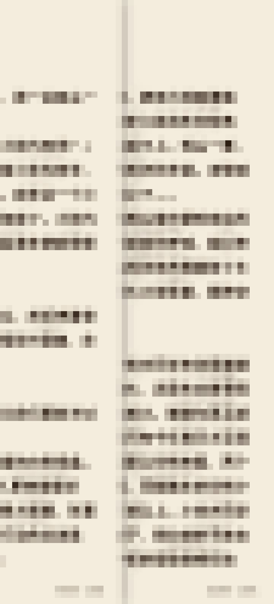
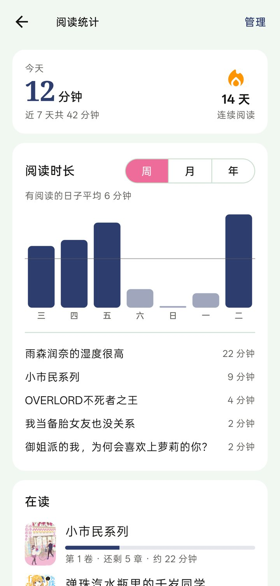

> [!WARNING]
> 本仓库不提供、也不会发布任何安装包，请自行编译

<div align="center">


# Ark Novel

轻小说文库（wenku8）第三方客户端，基于 Flutter，支持 Android 和 macOS。


</div>

<div align="center">
  
</div>

书架、阅读进度、书签和缓存的正文都保存在本地，没网或未登录时也能继续看；登录后可与网站书架同步，多设备之间可以通过 WebDAV 同步数据。

> 截图中的正文已打码。

## 截图

<div align="center">
  
</div>

<div align="center">
   
</div>

<table>
  <tr>
    <td width="25%"></td>
    <td width="25%"></td>
    <td width="25%"></td>
    <td width="25%"></td>
  </tr>
  <tr align="center">
    <td>书架</td>
    <td>卷册</td>
    <td>阅读</td>
    <td>统计</td>
  </tr>
</table>

## 功能

**阅读**
- 翻页模式：上下滚动、左右滑动、仿真翻页、覆盖翻页；宽屏支持双页显示，跨章节连续翻页
- 操作方式：点击、拖动、鼠标滚轮、键盘方向键 / 空格，Android 支持音量键翻页（长按连续翻页）
- 排版设置：字号、行距、页边距、字体（内置霞鹜文楷、思源宋体，支持导入本地字体）、背景配色、亮度遮罩
- 朗读（TTS）：当前句高亮、自动翻页、定时停止、自动连读下一章
- 正则规则：支持正文替换和高亮（可用于过滤固定文本、标记人名或添加批注）

**书架与记录**
- 本地书架：支持离线使用；登录后可与网站书架双向同步，离线时的变更会在联网后同步
- 分类与整理：支持一书多分类、筛选（未读 / 已缓存 / 已完结）、多种排序及视图切换
- 卷册显示：按卷展示封面，支持从 [Bangumi](https://bgm.tv) 获取单卷封面或手动选择图片
- 检查更新：支持逐本检查新章节，按更新时间分组显示
- 阅读记录：书签、历史记录、书籍墙、阅读时长统计（支持按书清除）和单书阅读报告导出

**离线缓存**
- 阅读时自动缓存当前章节并预加载后续章节及插图
- 支持打开书籍后在后台缓存整本正文（可关闭，或仅在 Wi-Fi 下执行），也支持在目录页多选章节手动缓存
- 书籍详情与目录优先读取本地缓存，联网后静默刷新
- 封面超分：内置 Real-ESRGAN 模型，可在本地放大模糊封面（仅 Android）

**同步与备份**
- WebDAV 同步：支持同步阅读进度、书架、书签、统计、正则规则和设置，可勾选同步项
- 本地备份：导出为 zip 压缩包，包含书架、进度、统计、评分和设置（不含封面、正文缓存及账号密码）

**其他**
- 发现页：推荐、排行榜、分类检索、完结列表、书名 / 作者搜索、书评查看与回复
- Android 桌面小组件：显示最近阅读的书籍
- 应用锁（生物识别 / 锁屏密码）、无痕模式
- Material Design 3 界面，支持深浅色模式与多套配色，针对 macOS 调整了标题栏与键鼠交互
- 网络设置：可切换 `wenku8.cc` / `wenku8.net` 线路，支持 HTTP 代理，遇到 Cloudflare 拦截时可通过内置网页验证

## 平台

| 平台 | 状态 |
|---|---|
| Android | 支持（release 包仅含 arm64） |
| macOS | 支持，需自行编译 |
| iOS / Windows / Linux | 不支持 |
| Web | 仅用于开发时通过 `tool/preview_proxy.dart` 预览界面 |

## 编译

本项目不提供安装包，请自行编译使用（见顶部说明）。

1. 安装 [Flutter](https://docs.flutter.dev/get-started/install)（开发环境为 stable 3.47）；编译 macOS 版需安装 Xcode
2. 克隆仓库并安装依赖：`flutter pub get`
3. 编译：

   ```bash
   # Android
   flutter build apk --release --target-platform android-arm64 --dart-define=cronetHttpNoPlay=true --obfuscate --split-debug-info=build/symbols -t lib/next/main.dart

   # macOS
   flutter build macos --release -t lib/next/main.dart
   ```

   - `cronetHttpNoPlay`：使用内置 Cronet 网络栈，不依赖 Google Play 服务
   - `--obfuscate --split-debug-info`：拆分调试符号以减小体积，崩溃堆栈需通过 `build/symbols` 还原
4. 运行测试：`flutter test`

项目入口为 `lib/next/main.dart`（`lib/main.dart` 仅作转发）。

<details>
<summary>从旧版（Hikari Novel）迁移数据</summary>

改名后 Android 包名变更为 `io.github.chenshi221.ark_novel`，系统会视为独立应用，无法直接覆盖安装。可通过以下任一方式迁移数据：

- **本地备份**：在旧版「设置 → 数据与存储 → 导出完整备份」，安装 Ark Novel 后在同一位置导入。旧版备份为 JSON 格式，导入时只合并、不覆盖，且不含更新记录、卷列表和按章统计
- **WebDAV 同步**：旧版先执行一次同步，随后将网盘中的 `hikari` 文件夹改名为 `ArkNovel`（或在 Ark Novel 的同步设置中将目录改为 `hikari`），再登录同一账号同步

确认数据完整迁移后再卸载旧版。

</details>

## 声明

- 本项目出于个人兴趣与客户端开发学习制作，仅限学习交流使用
- 所有数据均来自轻小说文库公开页面，不提供任何破解或付费内容
- 本项目为个人项目，与轻小说文库官方无关

## 致谢

Ark Novel 衍生自 [15dd/hikari_novel_flutter](https://github.com/15dd/hikari_novel_flutter)。**原项目 Hikari Novel 由 [15dd](https://github.com/15dd) 开发**，同时感谢原项目的其他贡献者（cyh128、HExplorers-Smx、Hexplore 等）。

Ark Novel 在原项目基础上使用 Riverpod + go_router 重写了界面，并增加了本地书架、离线阅读、朗读、同步等功能；网络请求与解析层（`lib/data/wenku8`）仍沿用原项目实现。遇到问题请在本仓库提 issue，请勿打扰原作者。

同时感谢以下项目：

- [mihon](https://github.com/mihonapp/mihon)：本地书架、分类与筛选交互参考
- [flutter_dmzj](https://github.com/xiaoyaocz/flutter_dmzj)、[venera](https://github.com/venera-app/venera)、[mikan_flutter](https://github.com/iota9star/mikan_flutter)、[pilipala](https://github.com/guozhigq/pilipala)、[PiliPalaX](https://github.com/orz12/PiliPalaX)、[PiliPlus](https://github.com/bggRGjQaUbCoE/PiliPlus)：原项目参考的开源项目
- [Real-ESRGAN](https://github.com/xinntao/Real-ESRGAN)：封面超分使用的 `realesr-animevideov3` 模型（BSD-3-Clause，© Xintao Wang），转换为 TFLite 格式存放于 `android/app/src/main/assets/sr_x4.tflite`
- [Bangumi](https://bgm.tv)：单卷封面数据来源
- [霞鹜文楷](https://github.com/lxgw/LxgwWenKai)、[思源宋体](https://github.com/notofonts/noto-cjk)：内置字体

## 许可证

[MIT](./LICENSE)。原始代码 © 2026 [15dd](https://github.com/15dd)，修改部分 © 2026 [chenshi221](https://github.com/chenshi221)，保留原作者版权声明。
