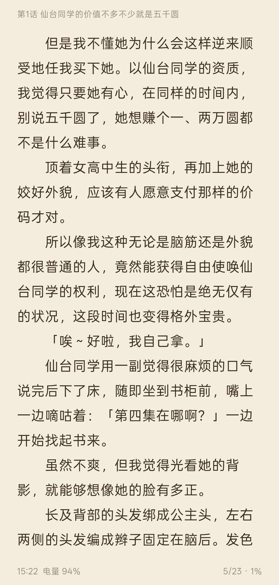
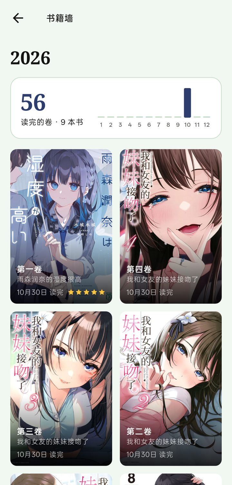

> [!WARNING]
> **编译出来就自己用，不要发到任何地方。** 本项目的前身 Hikari Novel 就是因为安装包被到处传而关停的。本仓库不提供、也不会发布任何安装包。

<div align="center">


# Ark Novel

**把喜欢的轻小说装上方舟。**

一个本地优先的轻小说文库（wenku8）第三方 Android 客户端，用 Flutter 编写。


</div>

## ⛵ 为什么叫 Ark

Ark 是「方舟」：书一旦上了船，就留在你自己的手机上。网站上不去、被 Cloudflare 拦住、没登录、没网，都不影响你接着读。书架、进度、书签、缓存的正文和封面全都存在本地，需要的话再通过 WebDAV 在多台设备之间同步。

## ✨ 功能

**书架**
- 本地书架：数据都存在本机，打开就有，离线可看，不登录也能用
- 定期和网站书架双向同步：本地的加入、移出会推到网站，离线时先排队
- 本地分类：一本书可以放进多个分类，分类可新建、改名、删除、拖动排序
- 筛选（有未读、有缓存、已完结）、6 种排序，网格 / 紧凑 / 列表三种显示，封面上一键继续阅读
- 卷册模式：每卷一张封面，可以从 [Bangumi](https://bgm.tv) 找各卷的封面，也可以自己挑
- 检查更新：逐本检查新章节，「更新」页按日期分组

**阅读**
- 上下滚动、左右滑动、仿真翻页、覆盖翻页；宽屏双页；音量键和键盘翻页
- 字号、行距、页边距、字体（内置霞鹜文楷、思源宋体，也可以选自己的字体文件）、多种阅读背景、亮度遮罩
- 页眉页脚显示时间、电量和本章进度
- 朗读：句子高亮并自动翻页、定时停止、读完自动读下一章、手动翻页后从新位置接着读
- 正则规则：替换（去广告、统一用字）和高亮（人物名染色、备注）
- 书签、阅读历史、阅读统计，以及每本书的阅读报告（可存成图片分享）

**离线**
- 读过的章节自动缓存，并预取后面两章；可以缓存全本，也可以在目录里多选章节缓存
- 详情和目录先显示本地存的，再联网刷新；封面和插图存在本地
- 封面「提升清晰度」：在本机用超分模型把书架上的模糊封面放大

**其他**
- 坚果云等 WebDAV 多设备同步（进度、书签、统计、规则），本地备份导入导出
- 发现页：推荐、排行、分类、完结；按书名或作者搜索；书评与回复
- 详情页：目录倒序，多选章节批量标记已读 / 未读
- 桌面小组件：显示最近在读的书，点一下直接继续
- 应用锁（生物识别 / 锁屏密码）、无痕模式
- Material Design 3，深浅色，多套配色（含角色主题）；手机、平板自适应
- 网络：可切换 wenku8.net / wenku8.cc 线路，支持 HTTP 代理；默认走系统网络栈（Cronet），被 Cloudflare 拦截时用内置浏览器验证

## 📱 支持平台

| 平台 | 状态 |
|---|---|
| Android | 唯一支持的平台（release 包只含 arm64） |
| iOS / macOS / Windows / Linux / Web | 不支持（Web 只在开发时用 `tool/preview_proxy.dart` 预览界面） |

## 🖼️ 截图

发现 · 书架（卷册模式） · 一本书的各卷

<div align="center">
    
</div>

阅读 · 书籍墙 · 阅读统计

<div align="center">
    
</div>

## 💻 编译

本项目不提供安装包，请自行编译、自己使用（见顶部警告）。

1. 安装 [Flutter](https://docs.flutter.dev/get-started/install)（开发用的是 stable 3.47）
2. 克隆本仓库，执行 `flutter pub get`
3. 编译：

   ```bash
   flutter build apk --release --target-platform android-arm64 --dart-define=cronetHttpNoPlay=true --obfuscate --split-debug-info=build/symbols -t lib/next/main.dart
   ```

   - `cronetHttpNoPlay`：让系统网络栈使用内置的 Cronet，不依赖 Google 服务
   - `--obfuscate --split-debug-info`：把调试符号拆到安装包外，包更小；崩溃堆栈需要用 `build/symbols` 还原
4. 测试：`flutter test`

入口是 `lib/next/main.dart`（`lib/main.dart` 只是转过去）。

### 从 Hikari Novel（本项目改名前的版本）迁移

改名后 Android 包名变成了 `io.github.chenshi221.ark_novel`，系统会把它当作一个新 App，旧版不会被覆盖升级，数据也不会自动带过来。迁移方法任选一种：

- **本地备份**：在旧版「设置 → 数据与存储 → 导出完整备份」，装好 Ark Novel 后在同一位置「导入备份」
- **WebDAV 同步**：旧版先同步一次，Ark Novel 填上同样的账号就能拉下来（默认同步文件夹仍然是 `hikari`，不用改）

确认数据都过来以后，再卸载旧版。

## 📣 声明

- 本项目出于兴趣和学习移动端开发而制作，仅用于学习和测试
- 所用接口均来自轻小说文库官方网站的公开页面，不提供任何破解内容
- 本项目是个人项目，与轻小说文库官方无关

## 🙏 致谢

Ark Novel 源自 [15dd/hikari_novel_flutter](https://github.com/15dd/hikari_novel_flutter)。**Hikari Novel 由 [15dd](https://github.com/15dd) 创作**，也感谢原项目的其他贡献者（cyh128、HExplorers-Smx、Hexplore 等）。

在原项目的基础上，Ark Novel 改用了新的框架（Riverpod + go_router）重写界面，加入了本地书架、离线阅读、朗读、同步等功能。网站请求和解析层（`lib/data/wenku8`）仍然沿用原项目的实现。Ark Novel 的问题请在本仓库提 issue，不要去打扰原作者。

还要感谢这些项目：

- [mihon](https://github.com/mihonapp/mihon)：本地书架、分类、筛选的设计参考
- [flutter_dmzj](https://github.com/xiaoyaocz/flutter_dmzj)、[venera](https://github.com/venera-app/venera)、[mikan_flutter](https://github.com/iota9star/mikan_flutter)、[pilipala](https://github.com/guozhigq/pilipala)、[PiliPalaX](https://github.com/orz12/PiliPalaX)、[PiliPlus](https://github.com/bggRGjQaUbCoE/PiliPlus)：原项目的参考
- [Real-ESRGAN](https://github.com/xinntao/Real-ESRGAN)：封面「提升清晰度」使用的 realesr-animevideov3 模型（BSD-3-Clause，© Xintao Wang），转成 TFLite 后放在 `android/app/src/main/assets/sr_x4.tflite`
- [Bangumi](https://bgm.tv)：各卷封面来源
- [霞鹜文楷](https://github.com/lxgw/LxgwWenKai)、[思源宋体](https://github.com/notofonts/noto-cjk)：内置字体

## 📄 许可证

[MIT](./LICENSE)。原始代码 © 2026 [15dd](https://github.com/15dd)，Ark Novel 的修改 © 2026 [chenshi221](https://github.com/chenshi221)，原作者的版权声明保留不变。
